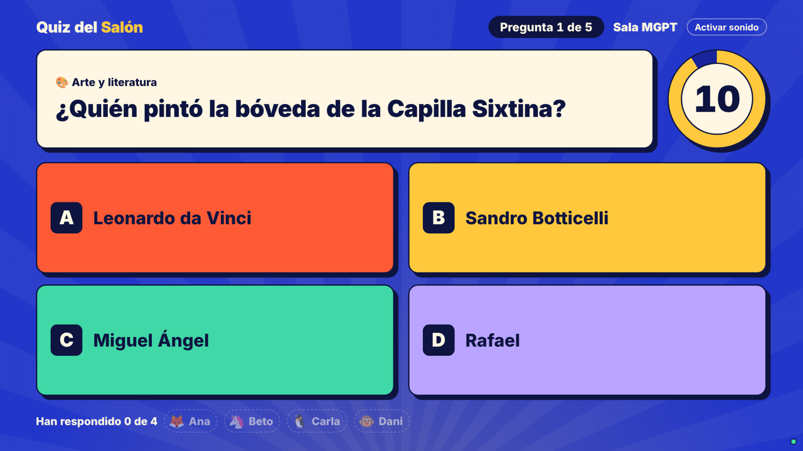
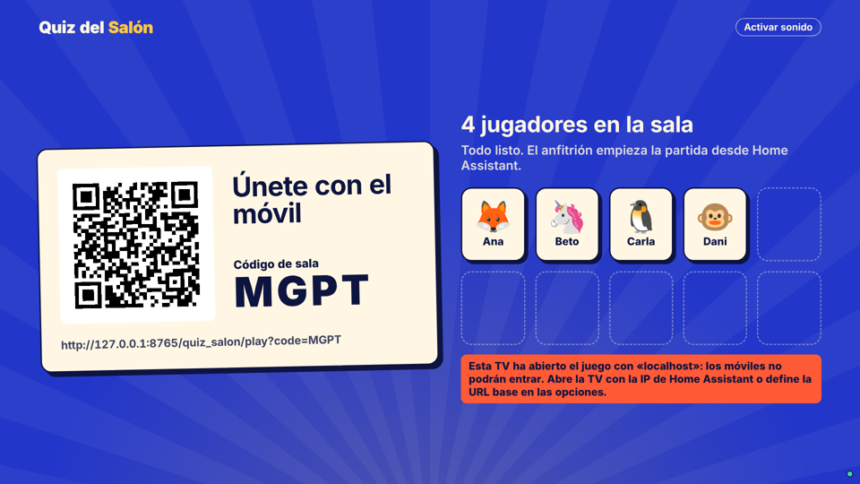
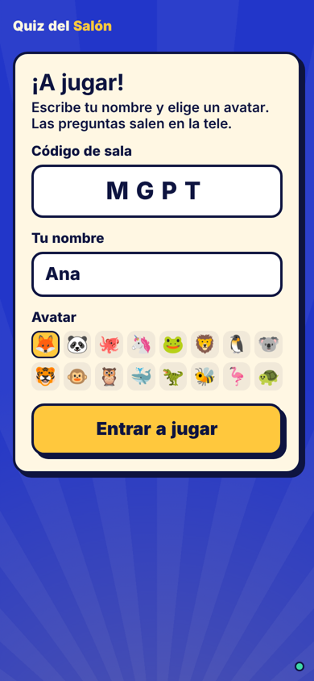
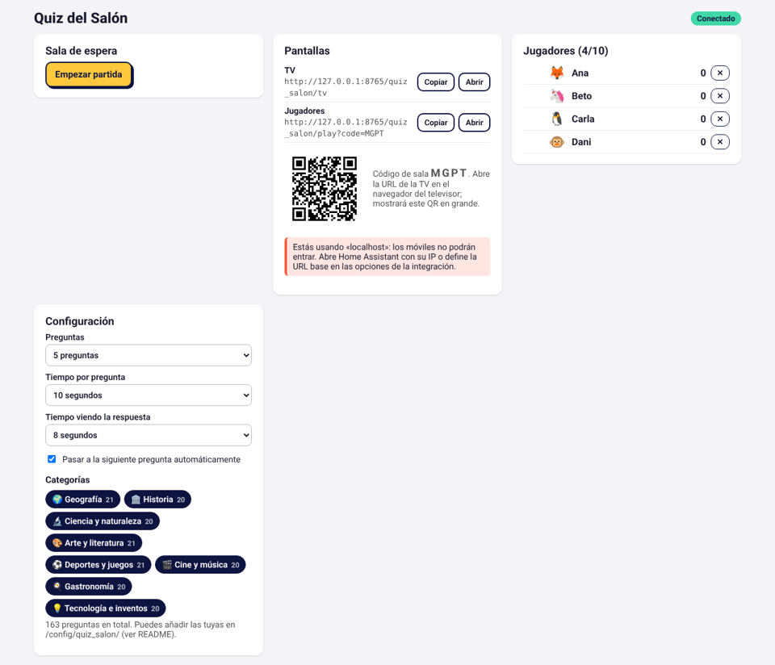

# Quiz del Salón

Juego de preguntas multijugador para **Home Assistant**. La tele muestra las preguntas, el temporizador y el marcador; cada jugador responde desde el navegador de su móvil escaneando un QR. Todo funciona en tu red local, sin apps, cuentas ni servicios en la nube.



- 2 a 10 jugadores, respuesta simultánea.
- 163 preguntas originales en español, en 8 categorías: Geografía, Historia, Ciencia y naturaleza, Arte y literatura, Deportes y juegos, Cine y música, Gastronomía, Tecnología e inventos.
- Puntos por acertar y por rapidez, bonus de racha y última pregunta doble.
- El servidor (Home Assistant) controla tiempos, respuestas y puntuaciones.
- El anfitrión controla la partida desde un panel de Home Assistant protegido por tu login de administrador.
- Puedes añadir tus propias preguntas con un archivo JSON.

| TV | Móvil | Anfitrión |
|---|---|---|
|  |  |  |

## Requisitos

- Home Assistant **2025.1 o posterior** (cualquier tipo de instalación: OS, Container, Core o Supervised).
- TV con navegador moderno (Chromecast con Google TV, Fire TV con Silk, Android TV, un portátil por HDMI…) y móviles en la **misma red** que Home Assistant.
- No necesita dependencias externas ni conexión a Internet.

## Instalación

### Opción A: HACS (repositorio personalizado)

1. En Home Assistant: **HACS → ⋮ → Repositorios personalizados**.
2. Pega `https://github.com/VivekMahtani/quiz-salon` y elige la categoría **Integración**.
3. Busca **Quiz del Salón** en HACS y pulsa **Descargar**.
4. Reinicia Home Assistant.
5. Ve a **Ajustes → Dispositivos y servicios → Añadir integración** y busca **Quiz del Salón**.

### Opción B: manual

1. Descarga `quiz_salon-1.0.0.zip`.
2. Descomprímelo dentro de la carpeta de configuración de Home Assistant (la que contiene `configuration.yaml`). Debe quedar así:
   ```
   /config/custom_components/quiz_salon/manifest.json
   ```
   Puedes usar el complemento *Samba share*, *File editor*, *Studio Code Server* o `scp`.
3. Reinicia Home Assistant.
4. **Ajustes → Dispositivos y servicios → Añadir integración → Quiz del Salón**.

Para comprobar que ha cargado, verás **Quiz del Salón** en la barra lateral (solo para administradores) y en **Ajustes → Sistema → Registros** el mensaje `Quiz del Salón: 163 preguntas cargadas`.

## Cómo se juega

1. **Abre la TV.** En el navegador del televisor, entra en
   `http://IP-DE-HOME-ASSISTANT:8123/quiz_salon/tv`
   (por ejemplo `http://192.168.1.50:8123/quiz_salon/tv`). Verás el QR, el código de sala y los huecos para jugadores. No hace falta iniciar sesión en la TV.
2. **Únete con los móviles.** Cada jugador escanea el QR (o abre `http://IP:8123/quiz_salon/play` y escribe el código de 4 letras), pone su nombre y elige avatar.
3. **Configura y empieza.** El anfitrión abre **Quiz del Salón** en la barra lateral de Home Assistant (desde el móvil con la app Companion o desde otro navegador), elige número de preguntas, tiempo y categorías, y pulsa **Empezar partida**.
4. **Responde.** Cada pregunta dura el tiempo elegido. Toca una opción en el móvil: solo cuenta la primera. La pregunta termina cuando todos han respondido o se acaba el tiempo.
5. **Mira la tele.** Se revela la respuesta correcta, cuántos eligieron cada opción y el marcador. Tras unos segundos llega la siguiente pregunta (o el anfitrión pulsa **Siguiente pregunta**).
6. **Podio.** Al final la tele muestra a los tres primeros. El anfitrión puede empezar otra partida con los mismos jugadores.

El anfitrión también puede jugar: que abra la página de jugador en su móvil (botón **Abrir** junto a «Jugadores» en el panel).

### Puntuación

| Situación | Puntos |
|---|---|
| Fallo o sin respuesta | 0 (se pierde la racha) |
| Acierto | 500 + hasta 500 según lo rápido que respondas |
| Racha | +100 por el 2.º acierto seguido, +200 el 3.º, +300 a partir del 4.º |
| Última pregunta | Todo ×2 |

Desempate: más aciertos y, si persiste, menos tiempo total en los aciertos.

### Controles del anfitrión

**Empezar partida**, **Pausar / Reanudar** (congela el tiempo), **Mostrar pregunta ya**, **Cerrar pregunta**, **Siguiente pregunta**, **Terminar partida**, **Nueva partida** y **Expulsar** a un jugador. Las acciones irreversibles piden confirmación.

### Si alguien pierde la conexión

El móvil se reconecta solo y recupera su nombre y sus puntos (aunque recargue la página). Un jugador desconectado no bloquea la ronda. Si se cierra el panel del anfitrión, la partida sigue avanzando sola.

## Opciones

**Ajustes → Dispositivos y servicios → Quiz del Salón → Configurar**:

- **Solo red local** (activado por defecto): las páginas y el WebSocket del juego rechazan conexiones desde IP públicas. Déjalo activado si tu Home Assistant es accesible desde Internet.
- **URL base para la TV y los móviles**: dirección que se codifica en el QR. Por defecto se usa la dirección con la que la TV abrió el juego. Defínela (por ejemplo `http://192.168.1.50:8123`) si abres la TV con `localhost`, con un nombre que los móviles no resuelven, o detrás de un proxy.

Los cambios se aplican al momento, sin cortar la partida.

## Preguntas propias

Crea la carpeta `/config/quiz_salon/` y añade uno o varios archivos `.json` con este formato (hay un ejemplo en [`docs/ejemplo-preguntas.json`](docs/ejemplo-preguntas.json)):

```json
{
  "categories": [{ "id": "familia", "name": "Mi familia", "icon": "🏠" }],
  "questions": [
    {
      "id": "fam-001",
      "category": "familia",
      "difficulty": 1,
      "q": "¿Cómo se llama el gato de la abuela?",
      "options": ["Misi", "Tom", "Leo", "Bigotes"],
      "answer": 0
    }
  ]
}
```

- `answer` es la posición (0–3) de la respuesta correcta; el juego baraja las opciones en cada partida.
- Exactamente 4 opciones distintas; pregunta de hasta 220 caracteres y opciones de hasta 80.
- `id` en minúsculas, números, `-` o `_`, y único. Puedes usar las categorías incluidas (`geografia`, `historia`, `ciencia`, `arte`, `deportes`, `espectaculos`, `gastronomia`, `tecnologia`) o crear las tuyas.
- Las preguntas inválidas se ignoran y se avisa en el registro de Home Assistant.

Tras añadir o cambiar archivos, recarga la integración (**⋮ → Recargar**) o reinicia Home Assistant. Si hay una partida en curso, recargar la termina.

## Automatizaciones

Cada cambio importante dispara el evento `quiz_salon_event` con `type` igual a `player_joined`, `game_started`, `question_started`, `question_revealed`, `game_finished` o `new_game`, además de `phase`, `code`, `players`, `question` y `leader`. Por ejemplo, para poner las luces de fiesta al terminar:

```yaml
automation:
  - alias: Luces de podio
    triggers:
      - trigger: event
        event_type: quiz_salon_event
        event_data:
          type: game_finished
    actions:
      - action: scene.turn_on
        target:
          entity_id: scene.fiesta
```

## Seguridad y privacidad

- Nada sale de tu red: sin analítica, sin CDN, sin cuentas. El QR se genera en Home Assistant.
- Solo los administradores de Home Assistant ven el panel y pueden obtener el token de anfitrión. La TV y los móviles nunca reciben credenciales de Home Assistant.
- El servidor valida cada mensaje, limita su tamaño y frecuencia y bloquea intentos repetidos con códigos de sala incorrectos.
- La respuesta correcta no se envía a ningún dispositivo hasta la revelación.
- Los nombres de los jugadores solo viven en memoria durante la partida; no se guardan en disco.

## Solución de problemas

| Problema | Solución |
|---|---|
| El QR abre una página que no carga en el móvil | El móvil debe estar en la misma wifi que Home Assistant (no en la red de invitados). Revisa la **URL base** en las opciones. |
| La TV avisa de «localhost» | Abre la TV con la IP de Home Assistant, no con `localhost`, o define la URL base. |
| «Solo disponible en la red local» | Estás entrando desde una IP pública o a través de un proxy que no informa de la IP real. Usa la IP local o desactiva la opción (no recomendado si HA está en Internet). |
| No aparece el panel en la barra lateral | Tu usuario debe ser administrador. Comprueba que la integración está añadida y recarga el navegador. |
| La TV muestra una versión antigua tras actualizar | Recarga la página de la TV (las URLs llevan la versión para evitar la caché). |
| El móvil se apaga durante la partida | Con HTTP los navegadores no permiten mantener la pantalla encendida; súbele el tiempo de bloqueo o usa HTTPS. |
| No se oye nada en la TV | Pulsa **Activar sonido** en la TV (los navegadores exigen una interacción antes de reproducir audio). |

## Actualizar y desinstalar

- **Actualizar con HACS**: HACS → Quiz del Salón → Actualizar, y reinicia Home Assistant.
- **Actualizar a mano**: sustituye la carpeta `custom_components/quiz_salon/` por la nueva y reinicia.
- **Desinstalar**: elimina la integración en **Ajustes → Dispositivos y servicios**, después elimínala en HACS (o borra `custom_components/quiz_salon/`) y reinicia. Si creaste preguntas propias, borra también `/config/quiz_salon/`. No queda ningún otro dato guardado.

## Desarrollo

```bash
python3 -m pip install pytest           # opcional: opencv-python-headless para el test del QR
python3 -m pytest                        # pruebas del motor, hub, QR, red, banco y capa HA (dobles)

# Servidor de desarrollo sin Home Assistant (mismo núcleo y mismo frontend)
python3 dev/devserver.py --port 8765
#   TV:        http://IP:8765/quiz_salon/tv
#   Jugadores: http://IP:8765/quiz_salon/play
#   Anfitrión: http://IP:8765/dev/host   (sin autenticación: solo para desarrollo)

# Pruebas de extremo a extremo con navegadores reales (requiere Playwright y Chrome)
python3 tests/e2e/run_e2e.py
python3 tests/e2e/run_full_room.py
```

Documentación técnica: [diseño del juego](docs/game-design.md), [arquitectura](docs/architecture.md) y [plan de pruebas](docs/test-plan.md).

## Licencia

Código y preguntas: MIT. «Quiz del Salón» es un proyecto independiente y no está afiliado a ningún juego de preguntas comercial.
